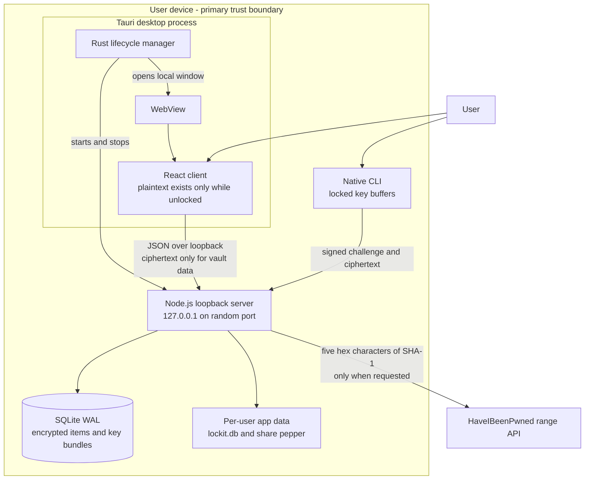
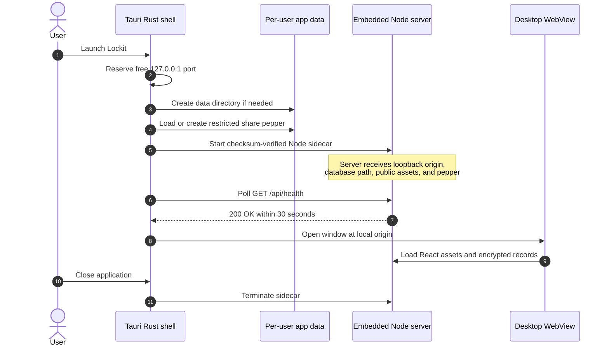
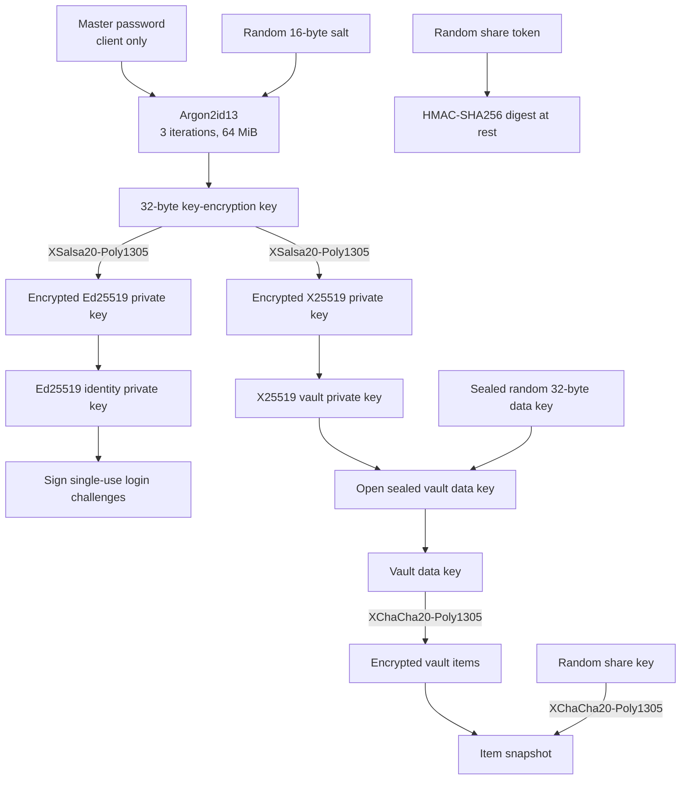
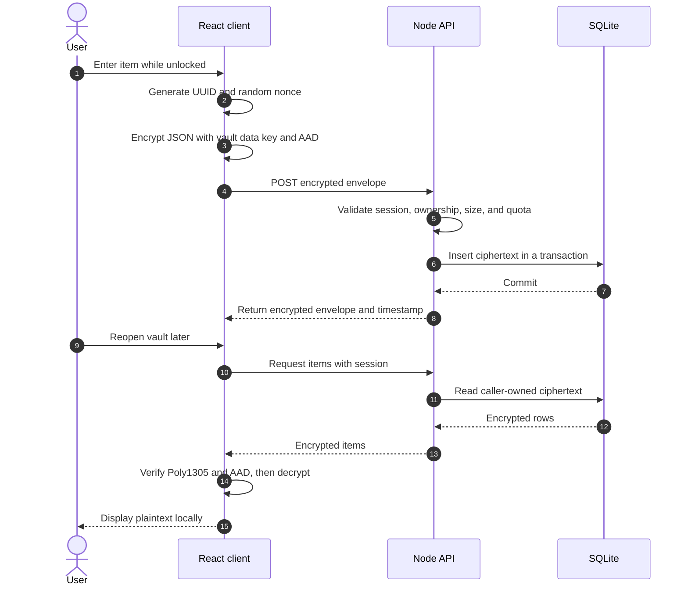
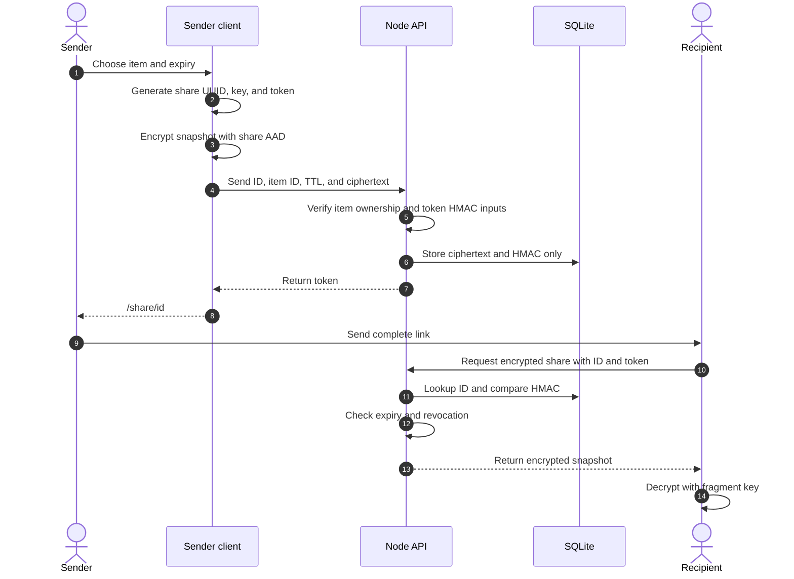
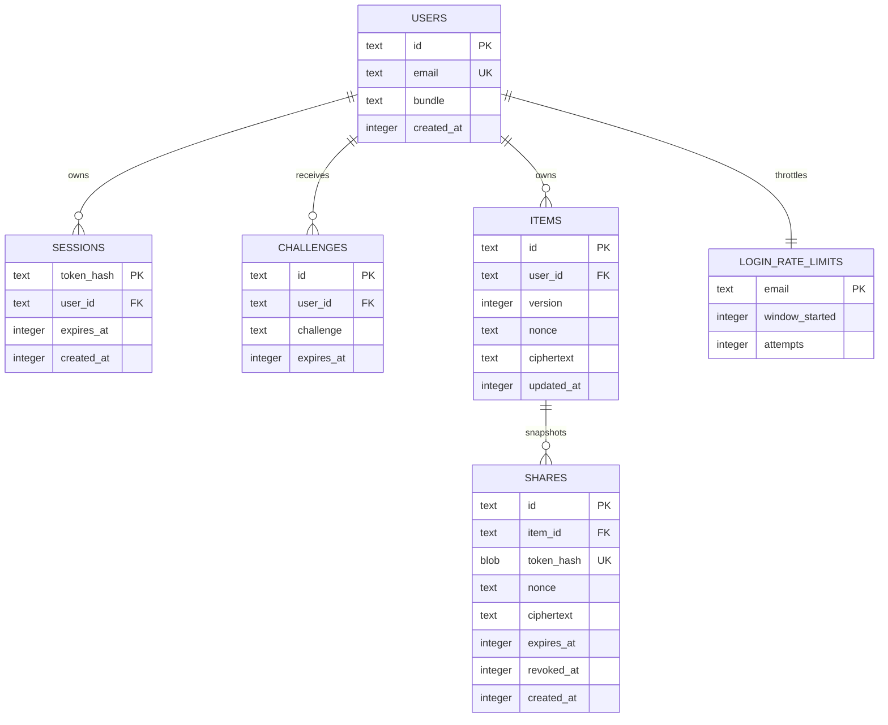
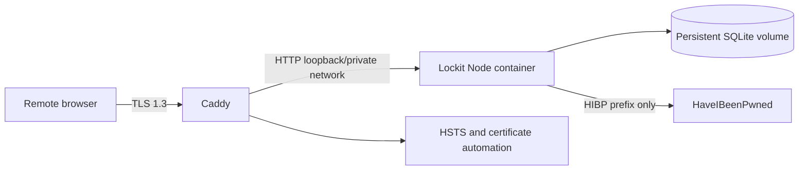
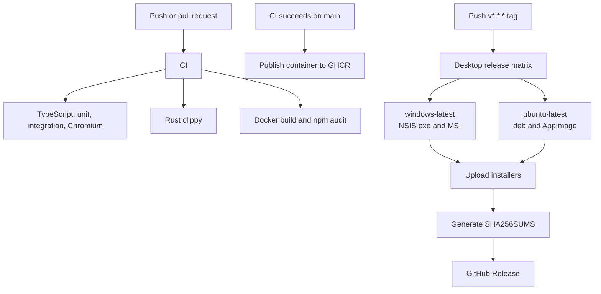

# Lockit

**A local-first, zero-knowledge vault for passwords, API keys, and documents.**

Lockit combines a Tauri desktop application, a React client, an embedded Node.js loopback server, and encrypted SQLite storage. Encryption and decryption happen only on the client. The server never receives the master password, plaintext vault items, private keys, or share decryption keys.

[](https://github.com/iszzy1516-cmyk/lockit/actions/workflows/ci.yml)
[](https://github.com/iszzy1516-cmyk/lockit/actions/workflows/desktop-release.yml)

## Contents

- [Product capabilities](#product-capabilities)
- [Installation](#installation)
- [Architecture](#architecture)
- [Cryptographic design](#cryptographic-design)
- [Core workflows](#core-workflows)
- [Data and consistency model](#data-and-consistency-model)
- [API overview](#api-overview)
- [Configuration](#configuration)
- [Local development](#local-development)
- [Deployment](#deployment)
- [Release engineering](#release-engineering)
- [Verification](#verification)
- [Failure handling and recovery](#failure-handling-and-recovery)
- [Security boundaries](#security-boundaries)

## Product capabilities

| Area | Implementation |
|---|---|
| Vault items | Passwords, API keys, notes, and documents up to 2 MiB after Base64 encoding |
| Client encryption | XChaCha20-Poly1305 with fresh nonces and context-bound associated data |
| Master key derivation | Argon2id13, 3 iterations, 64 MiB, 16-byte random salt |
| Authentication | Ed25519 signatures over short-lived, single-use challenges |
| Sharing | Encrypted snapshots with bounded expiry, immediate revocation, and HMAC-verified bearer tokens |
| Breach checks | HaveIBeenPwned range API using a five-character SHA-1 prefix computed locally |
| Session protection | Eight-hour server sessions, five-minute idle lock, explicit lock and logout |
| Password changes | Private-key re-wrapping without changing vault data; other server sessions revoked |
| Native CLI | Locked sensitive buffers, hidden password input, deterministic cleanup |
| Abuse controls | Registration and login throttles, item quotas, bounded HIBP concurrency |
| Deployment | Local desktop, local browser, or optional Docker deployment behind Caddy and TLS 1.3 |

### Platforms and packages

| Platform | Artifact | Build environment |
|---|---|---|
| Windows x64 | `.msi` | `windows-latest` GitHub Actions runner |
| Windows x64 | NSIS `.exe` | `windows-latest` GitHub Actions runner |
| Linux x64 | `.deb` | Ubuntu locally or `ubuntu-latest` runner |
| Linux x64 | `.AppImage` | Ubuntu locally or `ubuntu-latest` runner |

The installed desktop app includes the React client, server, and official Node.js runtime. Users do not need to install Node.js or Rust. Installers are currently unsigned; verify `SHA256SUMS.txt` and expect an unsigned-application warning until signing certificates are configured.

## Installation

### Install a desktop release

Download the appropriate package from [GitHub Releases](https://github.com/iszzy1516-cmyk/lockit/releases).

- **Windows:** install the MSI or run the NSIS installer.
- **Debian/Ubuntu:** install the `.deb` with `sudo apt install ./lockit_*.deb`.
- **Other Linux distributions:** make the AppImage executable and run it. On systems without FUSE, use `--appimage-extract-and-run`.

The app stores its encrypted database and randomly generated share pepper in the operating system's per-user Lockit data directory. Uninstalling the application does not imply secure deletion of that data; remove the data directory explicitly if required.

### Build the desktop application

Requirements:

- Node.js 22.12 or newer
- Stable Rust and Cargo
- Tauri's GTK/WebKitGTK dependencies on Linux
- Platform build tools required by Tauri

```sh
npm ci
npm run desktop:dev
```

Create optimized installers:

```sh
npm run desktop:build
```

Outputs are written under `src-tauri/target/release/bundle/`. The preparation script downloads the current official Node.js runtime and verifies it against Node's published SHA-256 checksum file before packaging.

### Run in a browser locally

```sh
npm ci
npm run local
```

Open `http://localhost:3000`. For hot-reload development:

```sh
npm run dev
```

Open `http://localhost:5173`. Vite proxies `/api` to the local server on port 3000. Do not expose development servers to a network.

## Architecture

### System context and trust boundaries

The desktop application is self-contained. The only intentional third-party request is an on-demand HIBP range lookup.



**Boundary rule:** plaintext items are visible to the React client or explicit CLI output. The Node process and SQLite database handle encrypted item envelopes and encrypted private-key bundles.

### Desktop process lifecycle



The Node runtime is bundled as a platform-specific sidecar. The compiled server and public client are packaged as resources. A failed sidecar start, missing resource, invalid pepper, or health timeout aborts startup rather than silently connecting to another service.

### Component responsibilities

| Component | Owns | Does not own |
|---|---|---|
| Tauri/Rust shell | Window lifecycle, loopback port, app-data paths, sidecar startup and shutdown | Vault keys and item plaintext |
| React client | Argon2id derivation, private-key unlock, item encryption, local search, share decryption | Authoritative persistent storage |
| Node.js server | Authentication verification, sessions, ownership checks, quotas, ciphertext persistence, HIBP proxy | Master passwords, item plaintext, private keys, share decryption keys |
| SQLite | Durable encrypted records, token digests, expiries, ownership relationships | Encryption or key derivation |
| Native CLI | Locked key buffers, challenge signing, item decryption for terminal use | Browser session state |
| Caddy, optional | Public TLS 1.3 termination, certificates, HTTP-to-HTTPS redirect | Vault decryption |

## Cryptographic design

### Key hierarchy



All binary network values use unpadded Base64url. Private keys and the vault data key are generated locally. The server stores public keys and encrypted key material.

### Encryption envelope

Each item is serialized as complete JSON and encrypted, including its title, username, secret, notes, URL, and document contents.

| Field | Purpose |
|---|---|
| `id` | Client-generated UUID and context-binding input |
| `version` | Envelope version, currently `1` |
| `nonce` | Fresh 24-byte XChaCha20 nonce for every save |
| `ciphertext` | Encrypted JSON plus Poly1305 authentication tag |
| `updatedAt` | Server timestamp used for display and ordering |

Item associated data is:

```text
lockit-item-v1:<identity-public-key>:<item-uuid>
```

Share associated data is:

```text
lockit-share-v1:<share-uuid>
```

Changing the account, item, share, nonce, or ciphertext causes authenticated decryption to fail.

### Authentication without a password verifier

1. The client requests a challenge and encrypted key bundle using its email.
2. Argon2id derives the key-encryption key locally.
3. The client unwraps the Ed25519 private key.
4. The client signs the random 32-byte challenge.
5. The server verifies the signature with the stored public key.
6. The server consumes the challenge atomically and issues an opaque session cookie.
7. Only the SHA-256 digest of the session token is stored.

Challenges expire after five minutes. Sessions expire after eight hours. Logout revokes the current session; a master-password change revokes other sessions.

**Important:** the pre-authentication key bundle permits offline password guessing. Argon2id raises its cost but cannot compensate for a weak master password.

## Core workflows

### Create and reopen an encrypted item



A server commit is the durable acknowledgement point for a vault write. A failed acknowledgement leaves the UI able to report failure rather than claiming a save succeeded.

### Create and open a secure share



The URL fragment is not included in HTTP requests. The authorization token and decryption key therefore stay out of ordinary request-path and proxy logs. The server sees the token in the JSON authorization request but never receives the decryption key.

Shares are bearer capabilities. Revocation prevents future opens but cannot erase plaintext or documents a recipient already saved.

### HIBP breach check

1. The browser hashes the password locally with SHA-1.
2. Only the first five uppercase hexadecimal characters are sent to `/api/hibp/:prefix`.
3. The authenticated server forwards the prefix with `Add-Padding: true`.
4. The client compares returned suffixes locally and reports compromised, not found, or unavailable.

The full password and full hash are never transmitted or stored. HIBP checks are user initiated; the server cannot perform plaintext background monitoring. Upstream failures never produce a false “not found” result.

## Data and consistency model

SQLite is the authoritative store. React state is a derived, in-memory view reconstructed from encrypted records after unlock. There is no replication, multi-node write coordination, or server-side plaintext index.



### Records, retention, and limits

| Concern | Contract |
|---|---|
| Users | Email is normalized and unique; the encrypted key bundle is stored as JSON |
| Items | Maximum 1,000 items and 64 MiB of decoded item ciphertext per user |
| Requests | JSON body limit 6 MiB; document limit 2 MiB after Base64 encoding |
| Challenges | Five-minute expiry and atomic single use |
| Sessions | SHA-256 token digest at rest; eight-hour expiry |
| Shares | TTL from 60 seconds to seven days; expired rows cleaned opportunistically |
| Login throttle | Persistent per-account counter plus bounded per-IP limits |
| HIBP | 30 requests/minute/account, four active upstream calls, 20 queued calls |
| HIBP upstream | Eight-second timeout, 1 MiB response cap, redirects rejected |
| Cleanup | Expired sessions, challenges, shares, and old throttles pruned at most once/minute |

### Durability and consistency

- SQLite runs in WAL mode with foreign keys and a five-second busy timeout.
- Item quota checks and inserts/updates occur in the same transaction.
- A write is acknowledged after the SQLite transaction commits.
- `synchronous=NORMAL` favors local desktop performance; host power-loss durability is not equivalent to `FULL`.
- The application is single-writer by design. Horizontal writes or multi-node active-active operation are out of scope.
- Server-side deletion or rollback of ciphertext is possible by a malicious host. AAD authenticates content and context, not freshness.
- Backups are operator/user responsibility. There is no built-in replication or point-in-time recovery.

## API overview

All application API routes are same-origin JSON routes. Vault payloads remain encrypted.

| Method and route | Purpose | Access |
|---|---|---|
| `POST /api/register` | Create account from public and encrypted key material | Public, throttled |
| `POST /api/auth/challenge` | Issue a login challenge and encrypted bundle | Public, throttled |
| `POST /api/auth/verify` | Verify Ed25519 signature and create session | Public |
| `POST /api/auth/logout` | Revoke current session | Session |
| `GET /api/auth/me` | Return current account identity | Session |
| `GET /api/auth/bundle` | Retrieve encrypted key bundle | Session |
| `PUT /api/auth/bundle` | Re-wrap private keys and revoke other sessions | Session |
| `GET /api/items` | List owned encrypted items | Session |
| `POST /api/items` | Create an encrypted item with quota enforcement | Session |
| `PUT /api/items/:id` | Replace an owned encrypted item | Session |
| `DELETE /api/items/:id` | Delete an owned item and cascade shares | Session |
| `GET /api/shares` | List shares for owned items | Session |
| `POST /api/shares` | Create an encrypted share snapshot | Session |
| `DELETE /api/shares/:id` | Revoke an owned share | Session |
| `POST /api/shares/open` | Open an unexpired, unrevoked encrypted share | Valid token |
| `GET /api/hibp/:prefix` | Proxy one five-hex-character HIBP range | Session, throttled |
| `GET /api/health` | Process and embedded-startup health check | Public |

Security behavior includes parameterized SQLite queries, strict ciphertext and UUID validation, Origin and Fetch Metadata checks, no-store API responses, request-size limits, generic authentication failures, and no request-body logging.

## Configuration

Copy `.env.example` only as a starting point. Never commit real environment files or secrets.

| Variable | Default / requirement | Purpose |
|---|---|---|
| `PORT` | `3000` | Node listen port; desktop assigns a free port |
| `LOCKIT_DB_PATH` | `./data/lockit.db` | SQLite path; desktop overrides with app-data path |
| `LOCKIT_PUBLIC_DIR` | `./dist/public` | Built React assets |
| `LOCKIT_PUBLIC_ORIGIN` | Development loopback origin | Expected browser origin; production requires HTTPS |
| `LOCKIT_SHARE_PEPPER` | Required in production | HMAC key for share-token digests; at least 32 bytes |
| `LOCKIT_TRUST_PROXY` | `false` | Trust the first `X-Forwarded-For` value only behind a trusted proxy |
| `LOCKIT_SERVER` | `http://127.0.0.1:3000` | CLI server origin; remote CLI requires HTTPS |
| `LOCKIT_NO_BROWSER` | Unset | Set to `1` to suppress browser opening in local launcher |
| `TAURI_TARGET` | Host target | Select the sidecar target during release preparation |

Production configuration refuses to start without an HTTPS origin and a strong share pepper. Desktop mode generates and protects its own pepper rather than using the development fallback.

## Local development

### Commands

| Command | Purpose |
|---|---|
| `npm run dev` | Vite client and Node API with hot reload |
| `npm run local` | Build and run the browser-local production app |
| `npm run desktop:prepare` | Download and checksum-verify the Node sidecar |
| `npm run desktop:dev` | Start the Tauri development application |
| `npm run desktop:build` | Build client, server, sidecar, and native installers |
| `npm run typecheck` | Strict server, browser, and CLI TypeScript checks |
| `npm test` | Unit and integration tests |
| `npm run test:e2e` | Real Chromium workflows against the real server |
| `npm run check` | Typecheck, tests, production build, and browser tests |
| `npm run cli -- --help` | Native CLI usage and memory-safety notes |

### Source layout

```text
lockit/
├── src/
│   ├── client/          React views, desktop UI, API client
│   ├── server/server/   Native Node HTTP and SQLite application
│   ├── shared/          API types and libsodium cryptography
│   └── cli/             Locked-memory native CLI
├── src-tauri/
│   ├── src/             Desktop lifecycle and sidecar management
│   ├── icons/           Application icons
│   ├── sidecar.mjs      Packaged server entry
│   └── tauri.conf.json  Window, resource, and installer configuration
├── scripts/             Development, local launch, sidecar preparation
├── tests/               Crypto, CLI, and server integration tests
├── e2e/                 Real Chromium workflows and visual checks
├── docs/                Threat model and audit simulation
└── .github/workflows/   CI, container CD, and desktop releases
```

## Deployment

Desktop and browser-local modes need no hosted service. For intentional multi-device or remote access, deploy the same Node application behind Caddy.



```sh
export LOCKIT_PUBLIC_ORIGIN=https://vault.example.com
export LOCKIT_SHARE_PEPPER="$(openssl rand -hex 32)"
docker compose up --build -d
```

Caddy obtains and renews certificates, exposes ports 80 and 443, requires TLS 1.3, and redirects HTTP to HTTPS. The application container runs as a non-root user with a read-only filesystem, no capabilities, and a persistent `/data` volume.

Back up both the SQLite volume and share pepper. Losing the pepper invalidates existing share authorization tokens but does not prevent vault decryption.

## Release engineering



### Workflow files

- `.github/workflows/ci.yml`: full verification, dependency audit, container build, Rust clippy.
- `.github/workflows/cd.yml`: GHCR publication after successful CI on `main`.
- `.github/workflows/desktop-release.yml`: native Windows/Linux installer builds and tagged GitHub Releases.

Release downloads are reproducible from source configuration, but byte-for-byte reproducible builds and installer signing are not currently claimed.

## Verification

```sh
npx playwright install chromium
npm run check
npm audit
```

Desktop-specific checks:

```sh
cargo fmt --manifest-path src-tauri/Cargo.toml --check
cargo clippy --release --manifest-path src-tauri/Cargo.toml -- -D warnings
npm run desktop:build
```

Verification coverage includes:

- Real libsodium registration, unlock, wrong-password rejection, and key re-wrapping.
- Item/share round trips, wrong AAD, nonce and ciphertext tampering.
- Challenge replay, session expiry/revocation, cross-user ownership, quotas, and throttles.
- Share HMAC verification, expiry, revocation, and token mismatch.
- HIBP prefix privacy, upstream errors, oversized responses, and authentication.
- CLI locked-buffer behavior and remote-HTTP rejection.
- Real Chromium creation and reopening of every item type, sharing, password change, and idle lock.
- Captured network and SQLite checks for plaintext and fragment-key leakage.
- Responsive desktop/mobile views and light/dark themes.
- Native installer builds on the appropriate operating systems.

`npm audit` checks known dependency advisories. It does not replace an independent cryptographic or native-code audit.

## Failure handling and recovery

| Failure | Behavior | Recovery |
|---|---|---|
| Wrong master password | Private-key authentication fails locally | Retry with the correct password; no server reset exists |
| Forgotten master password | Vault cannot be decrypted | Restore from a separately secured password backup if available; otherwise data is unrecoverable |
| Tampered ciphertext | Poly1305/AAD verification fails | Do not display the item; restore a known-good backup |
| Server returns stale or missing data | Client cannot prove freshness | Restore or compare backups; no signed history exists |
| Sidecar fails or health times out | Desktop startup fails with diagnostics | Check packaged resources, local permissions, and app-data access |
| HIBP unavailable or slow | Check ends as unknown after bounded timeout | Retry later; vault use continues offline |
| Share expires or is revoked | Public open returns not found | Sender creates a new snapshot |
| Share pepper lost | Existing share tokens no longer verify | Vault remains readable; create new shares |
| SQLite deleted without backup | Encrypted records are lost | No built-in recovery; restore user/operator backup |
| Other session exists after password change | Server revokes other session cookies | Already-unlocked clients and exported plaintext cannot be recalled |

### Explicit design decisions

- **No server-side decryption:** it would violate the zero-knowledge confidentiality invariant.
- **No plaintext title index:** it would leak item metadata; local search runs after decryption.
- **No server-side HIBP scheduler:** the server has no plaintext passwords to monitor.
- **No password-equivalent verifier:** signed key possession replaces reusable password proof.
- **No mandatory cloud account:** the desktop application works locally by default.
- **No custom cryptographic primitives:** libsodium supplies reviewed constructions.
- **No hidden recovery key:** recovery would create a second decryption path outside the stated trust model.

## Security boundaries

Read [the security architecture and audit simulation](docs/security.md) for the complete threat model, mitigations, memory limitations, and review evidence.

Key residual risks:

- Offline guessing against stolen encrypted bundles.
- Malicious client delivery or a compromised desktop/WebView.
- Email, item-count, size, timing, and HIBP-prefix metadata exposure.
- Server deletion or rollback of ciphertext.
- Browser/JavaScript memory copies and OS crash artifacts.
- Clipboard, downloads, terminal output, screenshots, and recipient-retained plaintext.
- Account-existence disclosure and targeted throttling denial of service.
- Unsigned installers until release-signing certificates are configured.

There is deliberately no master-password reset or hidden recovery route. This project has not undergone a real independent cryptographic audit.
